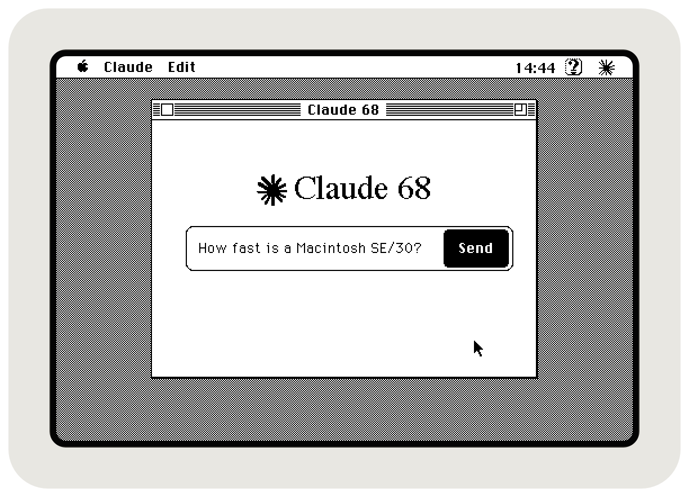
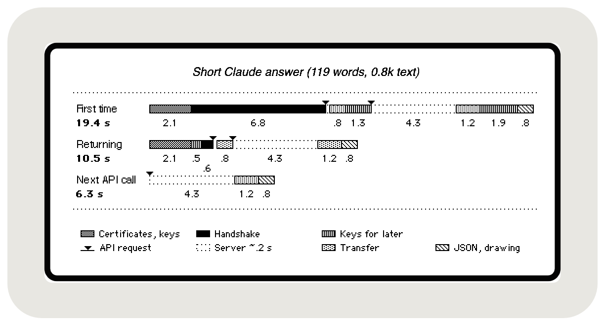

# Claude 68

**Talk to Claude from a Macintosh built before the web existed.**

Claude 68 is a little System 7 app that lets your 68k Mac chat with Claude. No proxy, no helper box: the 16 MHz 68030 does all the TLS math itself, straight to `api.anthropic.com`.

<p>
  
  
</p>

It's set up as a **boilerplate** too: make [three edits](#using-it-as-a-boilerplate) and it streams from your own API instead.

Funny thing: when I first asked Claude how to get a compact Mac onto HTTPS, it told me to use a proxy. So here's a Claude client without one.

---

## How fast

Out of the box, mbedTLS needs 49 seconds of math for one handshake on an SE/30, and Cloudflare gives up after about 15. With this engine, a short question on the SE/30 takes this long, from launching the app until Claude's answer is on screen:



- **First time:** a full handshake, which checks the certificate's signatures.
- **Returning:** resumed with the session ticket saved on disk.
- **Next API call:** the connection is still open, so there's no handshake at all.

Most of the dotted server time is Claude thinking and writing its answer, not the Mac. Timed in Claude 68's debug console with Open Transport 1.3 patched; the engine's own steps take the same time as in Notion Classic. The app connects while it starts up, so day to day you mostly just wait for the answer. The whole story is in [HTTPS on a 37-Year-Old Mac](https://github.com/SLKK-design/HTTPS-68K-Speedtest/blob/main/docs/modern-HTTPS-on-68k.md).

## Features

- **SSE streaming**: words appear as Claude writes them
- **Cancel mid-stream** with Esc or Cmd-.
- **Styled transcript**: your turns in bold, Claude's in plain text
- **Conversation memory**: recent messages go along with each new one, so Claude keeps up
- **Settings dialog** for your API key
- **Debug console**: a live, timestamped log in the chat window, toggled from the menu. Claude gets to read it too, and will happily help you debug.
- **Low-memory safety net**: a 32 KB reserve that steps in when memory runs short, then re-arms itself

> [!WARNING]
> The connection is encrypted, but the Mac isn't: any app on it can read the prefs file with your API key. So use a separate key you can revoke, with as few rights and as low a spending limit as the API allows.

## Requirements

```text
A Macintosh with at least:

CPU            68020
App partition  1.5 MB
System RAM     8 MB
OS             System 7.5
Network        Ethernet card, DaynaPORT, PiSCSI or BlueSCSI
```

> Using Open Transport 1.3? Give [Open Transport Bug Patcher](https://github.com/SLKK-design/HTTPS-68K-Speedtest/tree/main/OpenTransportBugPatcher) a run first.
> Otherwise every API call waits an extra 3 seconds.

## Download

<a href="https://github.com/SLKK-design/Claude68/releases/latest/download/Claude68.sit"></a>Grab [Claude68.sit](https://github.com/SLKK-design/Claude68/releases/latest/download/Claude68.sit) (StuffIt, for the Mac itself) or [Claude68.zip](https://github.com/SLKK-design/Claude68/releases/latest/download/Claude68.zip).

## Building

All you need is [Retro68](https://github.com/autc04/Retro68). mbedTLS for 68k and MacTCPHelper are already pre-built in `src/core/lib/`.

```bash
cmake -S . -B build -DCMAKE_TOOLCHAIN_FILE=<Retro68-build>/toolchain/m68k-apple-macos/cmake/retro68.toolchain.cmake
make -C build
```

You'll find `Claude 68.APPL` and `Claude68.bin` (MacBinary) in `build/`.

One tip: don't trust emulator timings. Basilisk II does a handshake in 0.2 s; a real 68030 needs 7 to 9.

### Using it as a boilerplate

Want to talk to a different API? It takes three edits: `src/config.h` (hostname, endpoint, headers, UI strings), `src/api/` (the request and the stream parsing; `api_template.cpp` is a commented skeleton) and the `project()` name in `CMakeLists.txt`.

If your server isn't behind Cloudflare's Google Trust Services chain, swap both certificates in `src/core/net/RootCert.cpp` too: the root, and the intermediate that signs your server's certificate. The `openssl` commands to get them are in `config.h`.

And give your app its own four-character creator code. Claude 68 uses `Cl68`, in `src/wdefshell.r` (twice) and `CMakeLists.txt`. Two apps sharing one confuse the Finder, and you may see one app's icon on the other.

## Sibling projects

<a href="https://github.com/SLKK-design/NotionClassic"></a>&nbsp; **[Notion Classic](https://github.com/SLKK-design/NotionClassic)**: reads and edits Notion pages.<br>
<a href="https://github.com/SLKK-design/MacPlayer"></a>&nbsp; **[MacPlayer](https://github.com/SLKK-design/MacPlayer)**: Anthony Super's Spotify remote, working again.<br>
<a href="https://github.com/SLKK-design/HTTPS-68K-Speedtest"></a>&nbsp; **[Speed Test](https://github.com/SLKK-design/HTTPS-68K-Speedtest)**: times every handshake method on your Mac.

## Credits

Made by **Lin van der Slikke** together with [Claude Code](https://claude.ai/code), which wrote most of the code (68k assembly included) and read the papers with me. I ran every build on the real machines, pored over the tick logs and decided what stayed.

Standing on the shoulders of:

- [MacHTTP](https://github.com/antscode/MacHTTP), [mbedtls-Mac-68k](https://github.com/antscode/mbedtls-Mac-68k) and [MacTCPHelper](https://github.com/antscode/MacTCPHelper) by Anthony Super (antscode). MacHTTP is where the HTTP client started, and his Spotify remote for the SE/30 is where this whole project started. Thank you, Anthony.
- [Retro68](https://github.com/autc04/Retro68) by Wolfgang Thaller, the 68k GCC toolchain
- [mbedTLS](https://github.com/Mbed-TLS/mbedtls) (ARM/Mbed, Apache 2.0)
- [micro-ecc](https://github.com/kmackay/micro-ecc) (Kenneth MacKay, BSD 2-clause)
- [curve25519-donna](https://github.com/agl/curve25519-donna) (Adam Langley / Google, BSD 3-clause)
- [http-parser](https://github.com/nodejs/http-parser) (Joyent / Node.js contributors, MIT), [yuarel](https://github.com/jackenl/yuarel) (Jack Engqvist Johansson, MIT), [gason](https://github.com/vivkin/gason) (Ivan Vashchaev, MIT)
- [Rivain (2011), *Fast and Regular Algorithms for Scalar Multiplication over Elliptic Curves*](https://eprint.iacr.org/2011/338.pdf), the co-Z ladder micro-ecc uses
- [PiSCSI](https://github.com/PiSCSI/piscsi) and [BlueSCSI](https://bluescsi.com/), for the SCSI network card emulation that puts the real machines online

## License

My code is released under [0BSD](LICENSE). Take it, change it, ship it; no credit needed. The bundled libraries keep their own licenses (see [THIRD_PARTY_LICENSES](THIRD_PARTY_LICENSES)).

---

*With a nod to a certain 1997 Apple ad: here's to the round pegs in the square holes, the ones daft enough to think a Mac from 1989 should stream from a frontier model. [It does now.](https://github.com/SLKK-design/Claude68/releases)*
